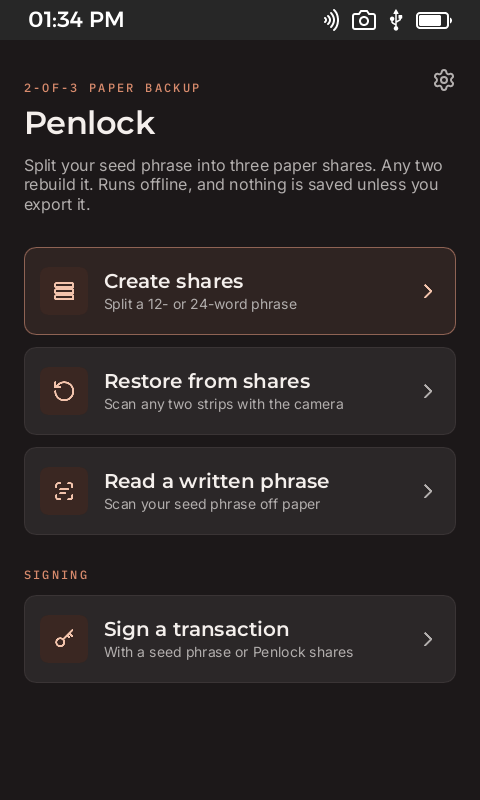
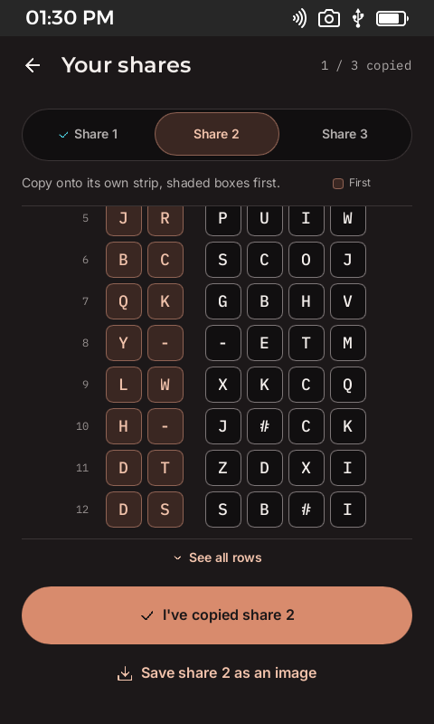
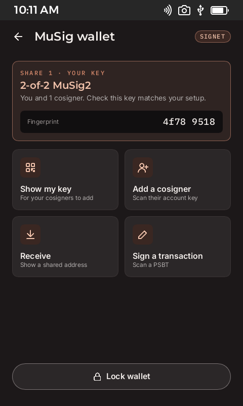
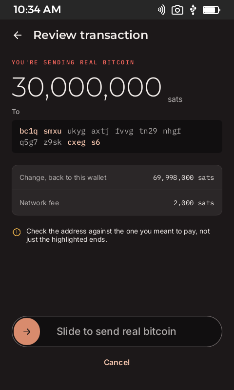

# Penlock

Paper seed backups and an offline transaction signer for [Passport Prime](https://foundation.xyz), as a KeyOS app.

> **Experimental. Don't risk more than you can afford to lose.** The signing code has not been audited, the app has only
> run in the KeyOS simulator, and coins sent to its MuSig addresses can only be spent with this code. It defaults to signet;
> mainnet is an opt-in setting.

| Home | Your shares | MuSig signer | Review |
| --- | --- | --- | --- |
|  |  |  |  |

Screenshots use a public test phrase.

A 2-minute walkthrough is in [`demo/penlock-demo.mp4`](demo/penlock-demo.mp4), with captions in
[`demo/penlock-demo.srt`](demo/penlock-demo.srt).

[`demo/penlock-seed-to-signature.mp4`](demo/penlock-seed-to-signature.mp4) follows one seed from a photo to shares, back
through two shares, to a signed mainnet transaction. Its seed and shares are hidden.

## What it does

- **Create shares.** Split a 12- or 24-word phrase into three paper shares. Any two rebuild it, and one alone reveals
  nothing. Tap a share to see all its rows at once, or save a 12-word share as a PNG that Upload photo can read back.
  Saved shares go in a `penlock` folder, named with the share number and the date and time in UTC.
- **Restore from shares.** Tap a share to upload a strip, or take a photo. Any two strips rebuild the phrase, in any order.
- **Read a written phrase.** Take or upload a photo of a handwritten phrase, then check every word of the draft against
  the paper. An uploaded photo reads better than the 480-pixel camera.
- **Sign with a seed.** Scan or type a phrase, or rebuild it from two shares, then import a PSBT and sign it. This covers
  the seed's own BIP84 addresses. It's one key signing, not multisig: the shares protect the seed on paper, and the whole
  seed is in memory while it signs.
- **Sign with cosigners.** Sign taproot transactions with MuSig2 over QR codes. A key can come from a seed phrase or from
  one share, so a Passport holding share 1 and another device holding share 2 can sign together without either seeing the
  other's share or the phrase.

Everything runs offline, on the device. Phrases, shares and keys stay in memory. The only thing written to storage is a
share you choose to export, and since any two shares rebuild the phrase, keep no more than one on any device.

Settings, behind the gear on the home screen, holds the network toggle. Turning mainnet on needs a confirmation. It
resets to signet on each launch, and it locks while a wallet is open because each network has its own keys.

## Getting started

You need the [KeyOS SDK](https://docs.foundation.xyz/developers/home/) 1.1.0 and Nix.

```sh
foundation develop   # enter the SDK shell
foundation sim       # build the app and open the simulator
```

Run the tests from the same shell, after one `foundation sim` has generated the theme and UI files:

```sh
export FOUNDATION_THEMES_RUST_DIR=$PWD/target/foundation/themes/rust
export FOUNDATION_UI_LIBRARY_PATH=$PWD/target/foundation/ui/ui
cargo test --bin my-app
(cd tools/musig-cosigner && cargo test)
```

## Trying MuSig signing

MuSig2 needs a second signer, and [`tools/musig-cosigner`](tools/musig-cosigner) is a laptop stand-in built on the same
signing code. Use throwaway phrases only.

```sh
cd tools/musig-cosigner
cargo run -- split "twelve test words" /tmp/shares          # write share-1.txt to share-3.txt
COSIGNER_SHARE="$(cat /tmp/shares/share-2.txt)" cargo run   # sign as share 2
```

Add `COSIGNER_NETWORK=mainnet` to sign on mainnet. The default is signet.

The tool prints its public key, then reads commands from stdin: `add <key>`, `address <index>`, or a PSBT to take the next
signing step. The header of [`src/main.rs`](tools/musig-cosigner/src/main.rs) lists them all, along with `rebuild` for a
lost share.

The simulator has a paste screen for keys and PSBTs. On a Passport these move by QR code.

## How it works

### Penlock

[Penlock](https://penlock.io) splits a BIP39 phrase into three paper shares, and needs no electronics: the paper version is
a printable wheel. Each word becomes six symbols from a 29-letter alphabet, with arithmetic in GF(29). A share is a point on
a line whose hidden value is the word, so two points fix the line, and one fits every possible word. A checksum on each word
catches a slip of the hand.

### How it's integrated

The app runs [Bitcoin Vision](https://github.com/penlock-io/bitcoin-vision) on the device, with no network anywhere in the
pipeline:

| Step | Crate | What happens here |
| --- | --- | --- |
| Split | `penlock` | Makes three shares, and checks that every pair recovers the phrase before showing any of them |
| Read a strip | `penlock-scan` | Reads a photo into a probability for each of the 29 symbols, not just a best guess |
| Recover | `penlock` | Combines two strips using those probabilities, so the word checksums can settle doubtful symbols |
| Read a phrase | `bitcoin-vision-words` | Reads a handwritten phrase into a draft you check word by word |

Keys come from those results in two ways. Two shares rebuild the phrase, which gives an ordinary BIP84 key. One share alone
goes through HMAC-SHA512 with a private tag to give a BIP86 key of its own, so the phrase is never rebuilt at all.

### Why MuSig2

Normally, spending from a backup means bringing two shares together, which is the moment they're most exposed. MuSig2
removes that moment. A Passport holding share 1 and a second device holding share 2 each sign with their own key, and
neither ever sees the other's share or the phrase. Both have to sign, so one lost or stolen device can't spend.

On chain the result is one 64-byte signature on an ordinary taproot output. It costs the same as a single-key spend and
doesn't reveal that two devices were involved.

The second device can be another Passport or a phone. Today the rounds pass as QR codes, and a laptop tool stands in as the
second signer, because the phone app isn't built yet. NFC isn't supported yet either: the SDK gives third-party apps NFC
status only. If Foundation opens NFC read and write to apps, adding tap-to-sign should be fairly easy, because each round is
already a self-contained PSBT and only the way it travels changes.

### How signing works

Penlock is a signing device. It has no network, holds no coins and doesn't track a balance, so it never looks up coins or
builds transactions. A wallet or coordinator elsewhere builds the PSBT and broadcasts the result.

1. Load a key: a seed phrase, two shares, or one share with a cosigner.
2. Import a PSBT. Every input must belong to the loaded key, or it's refused.
3. The Passport shows the destination, change and fee, and you slide to approve.
4. With a seed, the signed transaction appears as a QR code, ready to broadcast from an online device.

With MuSig2, each signer then adds a one-time nonce, then a partial signature, and either device checks the partial
signatures and joins them into one 64-byte signature.

A secret nonce is removed from the signer before any check runs, so it can never be used twice, even after a failure.
Signing stops if the transaction changes after approval.

## Project layout

| Path | Contents |
| --- | --- |
| `src/backup.rs` | Phrase checks, the 2-of-3 split, recovery |
| `src/scan.rs` | Reader threads for strips, handwriting and QR codes |
| `src/musig.rs` | Keys, addresses, PSBT rounds, nonces |
| `src/single.rs` | Signing with a seed, for its own BIP84 addresses |
| `src/penlock_ui.rs`, `src/wallet_ui.rs` | Screen logic |
| `ui/` | Slint screens, with the Prime Kit tokens in `ui/common.slint` |
| `resources/` | App icon, fonts and interface icons |
| `tools/musig-cosigner/` | Laptop cosigner. It signs, and doesn't build transactions |
| `vendor/` | Crates patched to compile for KeyOS |
| `demo/` | The walkthrough video and its captions |

## Known limits

- It has never run on a real Passport Prime. Hardware type-checks pass, but nothing has been linked or run.
- Mainnet mode has been tested against a local `bitcoind`, not with real coins on the live network.
- The seed phrase, two-share and one-share flows pass end to end on signet in the simulator. Those runs used made-up coins,
  so their signatures were checked by a separate verifier, not a node.
- No mainstream wallet can derive share keys or join these signatures, so keep this code with any coins it controls.
- A MuSig spend needs an outside coordinator to build its PSBT, and this repo no longer includes one.
- Seed signing covers native segwit (BIP84, `m/84'/0'/0'`) and the first 50 addresses on each chain. Inputs must carry
  `witness_utxo`, and the app can't yet export an xpub, so your wallet has to know the seed's account already.
- Scanning real paper strips, handwriting and QR codes through a camera is untested.
- The handwriting reader used about 450 MB on a Mac, so it may be too heavy for the device.
- There is no phone app yet, and a lost share can only be rebuilt with the laptop tool.
- Cosigners are re-added on each launch. One QR code holds about 2 KB, which limits a transaction to a few inputs.
- NFC isn't used, because the SDK gives third-party apps NFC status only. See [Why MuSig2](#why-musig2).

## Credits

Built with the Foundation KeyOS SDK and [Bitcoin Vision](https://github.com/penlock-io/bitcoin-vision). Signing uses the
[`musig2`](https://crates.io/crates/musig2) and [`bitcoin`](https://crates.io/crates/bitcoin) crates. Share keys use a
construction written for this app, so only this app or its laptop tool can derive them.

Source files carry MIT SPDX headers. Montserrat, Inter and IBM Plex Mono are under the SIL Open Font License, with
copies in [`licenses/`](licenses).
