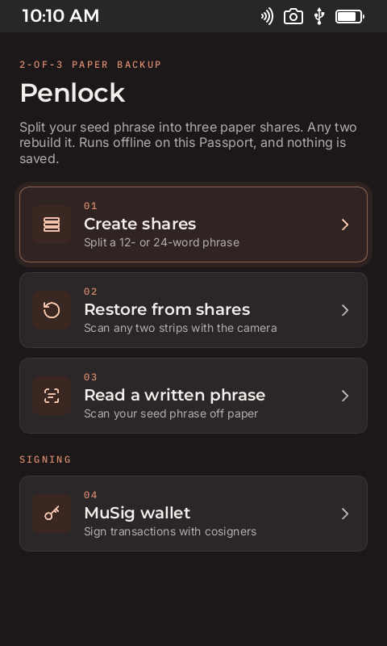
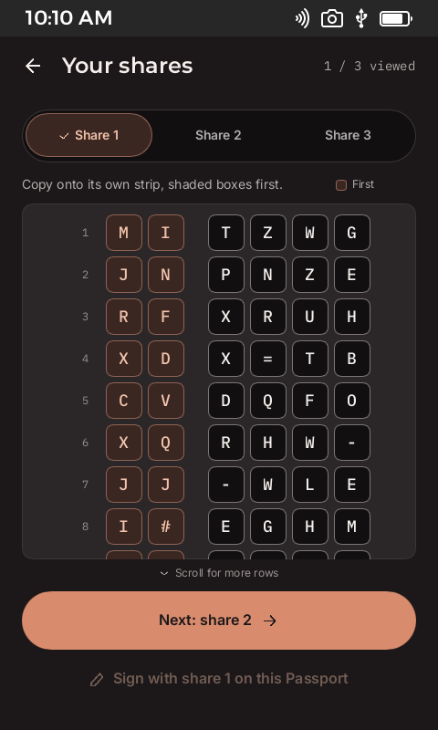

# Penlock

Paper seed backups and multisig signing for [Passport Prime](https://foundation.xyz), as a KeyOS app.

> **Experimental. Don't risk more than you can afford to lose.** The signing code has not been audited, the app has only
> run in the KeyOS simulator, and coins in these wallets can only be spent with this code. The wallet defaults to signet;
> mainnet is an opt-in setting.

| | | |
| --- | --- | --- |
|  |  |  |

A 2-minute walkthrough is in [`demo/penlock-demo.mp4`](demo/penlock-demo.mp4), with captions in
[`demo/penlock-demo.srt`](demo/penlock-demo.srt).

## What it does

- **Create shares.** Split a 12- or 24-word phrase into three paper shares. Any two rebuild it, and one alone reveals
  nothing.
- **Restore from shares.** Scan two strips with the camera to rebuild the phrase.
- **Read a written phrase.** Scan a handwritten phrase as a draft, then check every word against the paper.
- **MuSig wallet.** Sign taproot transactions with cosigners, using MuSig2 over QR codes. A key can come from a seed
  phrase or from one share, so a Passport holding share 1 and another device holding share 2 can sign together without
  either seeing the other's share or the phrase.

Everything runs offline, on the device. Phrases, shares and keys stay in memory and are never written to storage.

Settings, behind the gear on the home screen, holds the network toggle. Turning mainnet on needs a confirmation. It
resets to signet on each launch, and it locks while a wallet is open because each network has its own keys.

## Getting started

You need the [KeyOS SDK](https://docs.foundation.xyz/developers/home/) 1.1.0 and Nix.

```sh
foundation develop   # enter the SDK shell
foundation sim       # build the app and open the simulator
```

Run the tests from the same shell, after one `foundation sim` has generated the theme and UI files:

```sh
export FOUNDATION_THEMES_RUST_DIR=$PWD/target/foundation/themes/rust
export FOUNDATION_UI_LIBRARY_PATH=$PWD/target/foundation/ui/ui
cargo test --bin my-app
(cd tools/musig-cosigner && cargo test)
```

## Trying the wallet

MuSig2 needs a second signer, and [`tools/musig-cosigner`](tools/musig-cosigner) is a laptop stand-in built on the same
signing code. Use throwaway phrases only.

```sh
cd tools/musig-cosigner
cargo run -- split "twelve test words" /tmp/shares          # write share-1.txt to share-3.txt
COSIGNER_SHARE="$(cat /tmp/shares/share-2.txt)" cargo run   # sign as share 2
```

Add `COSIGNER_NETWORK=mainnet` to sign on mainnet. The default is signet.

The tool prints its public key, then reads commands from stdin: `add <key>`, `address <index>`, `script <chain> <index>`,
`new ...` to build a PSBT, or a PSBT to take the next signing step. The header of
[`src/main.rs`](tools/musig-cosigner/src/main.rs) lists them all, along with `rebuild` for a lost share.

The simulator has a paste screen for keys and PSBTs. On a Passport these move by QR code.

## How signing works

The Passport has no network, so another device builds the transaction as a PSBT and broadcasts the result.

1. The Passport shows the destination, change and fee, and you slide to approve.
2. Each signer adds a one-time nonce.
3. Each signer adds a partial signature.
4. Either device checks the partial signatures and joins them into one 64-byte signature.

A secret nonce is removed from the signer before any check runs, so it can never be used twice, even after a failure.
Signing stops if the transaction changes after approval.

## Project layout

| Path | Contents |
| --- | --- |
| `src/backup.rs` | Phrase checks, the 2-of-3 split, recovery |
| `src/scan.rs` | Reader threads for strips, handwriting and QR codes |
| `src/musig.rs` | Keys, addresses, PSBT rounds, nonces |
| `src/penlock_ui.rs`, `src/wallet_ui.rs` | Screen logic |
| `ui/` | Slint screens, with the Prime Kit tokens in `ui/common.slint` |
| `resources/` | App icon, fonts and interface icons |
| `tools/musig-cosigner/` | Laptop cosigner |
| `vendor/` | Crates patched to compile for KeyOS |
| `design-screens/` | A capture of every screen, using a public test phrase |

## Known limits

- It has never run on a real Passport Prime. Hardware type-checks pass, but nothing has been linked or run.
- Mainnet mode has been tested against a local `bitcoind`, not with real coins on the live network.
- No mainstream wallet can derive share keys or join these signatures, so keep this code with any coins it controls.
- Scanning real paper strips, handwriting and QR codes through a camera is untested.
- The handwriting reader used about 450 MB on a Mac, so it may be too heavy for the device.
- There is no phone app yet, and a lost share can only be rebuilt with the laptop tool.
- Cosigners are re-added on each launch. One QR code holds about 2 KB, which limits a transaction to a few inputs.
- NFC isn't used, because the SDK gives third-party apps NFC status only.

## Credits

Built with the Foundation KeyOS SDK and [Bitcoin Vision](https://github.com/penlock-io/bitcoin-vision). Signing uses the
[`musig2`](https://crates.io/crates/musig2) and [`bitcoin`](https://crates.io/crates/bitcoin) crates. Share keys use a
construction written for this app, so only this app or its laptop tool can derive them.

Source files carry MIT SPDX headers. Montserrat, Inter and IBM Plex Mono are under the SIL Open Font License, with
copies in [`licenses/`](licenses).
